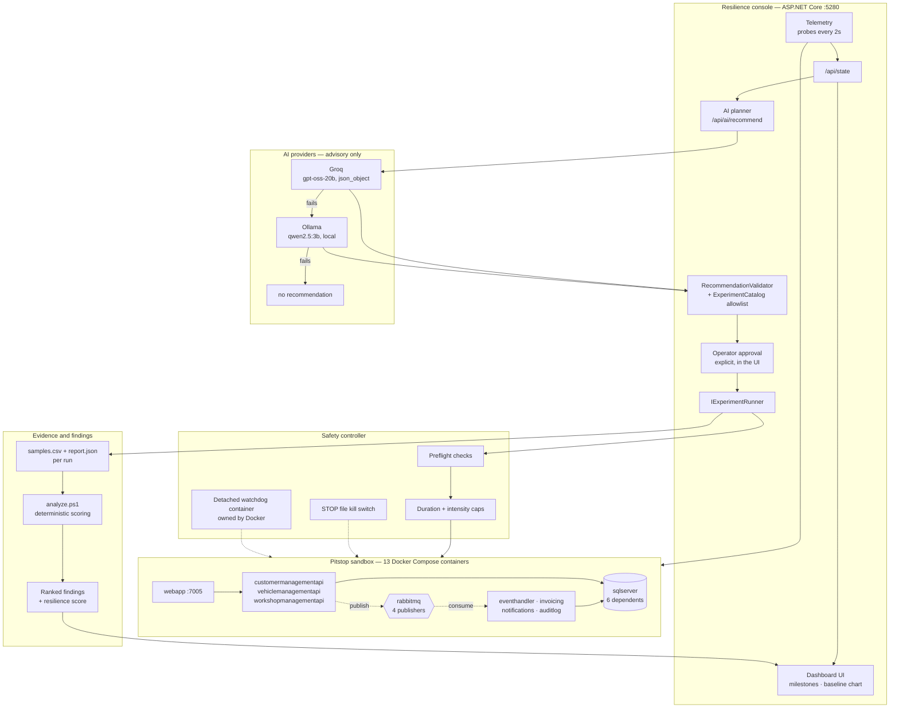

# Architecture overview

One page. Everything below matches code in this repository; the file that
implements each box is named.

## The system in one diagram

## What each piece is

**Sample application.** Upstream Pitstop, unmodified apart from a publisher fix
(`src/`). Three user-facing modules behind `webapp`, backed by SQL Server, with
RabbitMQ carrying domain events to four background workers.

**Discovery and dependency graph.** `chaos-scripts/map-dependencies.ps1` reads
Compose and merges a hand-curated event topology
(`dependency-overlay.json`). Inferred and curated edges stay distinguishable,
and the output records `mostDependedOn`, which is what identified `sqlserver`
(six dependents) as the highest topology risk.

**Telemetry.** The console probes all three module pages every 2 seconds for
status, latency and the "module is offline" fallback page — a 200 carrying that
page is a failure, and the probe says so. Each experiment additionally records
per-probe samples tagged `baseline`, `fault` or `recovery`, which is what the
dashboard chart draws.

**AI provider and fallback.** `AiProviderRouter` degrades Groq → Ollama →
nothing. "Nothing" is a designed outcome: no recommendation means nothing to
approve. Groq requests `json_object` and carries the contract in its system
message; Ollama takes the raw schema in `format`. Groq's strict `json_schema`
mode was dropped after it returned HTTP 400 on this contract — the trade-off is
that the provider no longer enforces the shape, so **the server-side allowlist
validation is the only thing standing between a malformed suggestion and the
operator**. That validation is unchanged and is what every safety claim rests
on. Note the 400 was last observed from a build predating the
`max_completion_tokens` fix, so strict mode may now work; it has not been
retested. The provider that actually answered is always attributed in the UI,
so a fallback can never be mistaken for a Groq success.

**The model boundary.** This is the core safety property. `ExperimentCatalog`
is the only allowlist. `RecommendationValidator` rejects any experiment name,
target or duration outside it — targets come from the catalog, never from the
model, and out-of-range values are rejected rather than clamped. Model-proposed
ideas that are not registered appear as *discoveries*, explicitly marked
not executable. **No score, ranking or number comes from a model.**

**Operator approval.** Required, in the UI, per run. A provider error is never
permission to act.

**Experiment execution.** `IExperimentRunner` is the only path to a real fault,
and the test suite substitutes a fake so no automated test can inject one.
Scripts are PowerShell, one per failure mode, with parameters passed as
separate argv entries — nothing from a request is interpolated into a command
string.

**Safety controller.** Four independent layers, in `ChaosSafety.psm1` and each
experiment:

1. *Preflight* — sandbox ownership, a local named-pipe Docker context only, and
   an exclusive lock so two experiments cannot run at once.
2. *Bounds* — a duration cap per experiment, tightest (30s) for the widest
   blast radius, plus a threshold that aborts if an unaffected module degrades.
3. *STOP file* — plain file and timer logic polled by the running script. It
   does not depend on the dashboard, the backend, or any model staying up.
4. *Watchdog* — a detached container owned by Docker that restores the target
   even if the orchestrator is killed. PowerShell background jobs were used
   here originally and were proven not to survive a parent kill; containers do.

**Recovery verification.** Judged on application behaviour — pages serving, and
where a write path exists, a write accepted — never on container status. A
restart is not trusted on its exit code either: the container's state is checked
before the watchdog is released.

**Findings.** `analyze.ps1` scores each run over five weighted dimensions,
records which dimensions were *not* measured, assigns confidence from probe
count, and emits ranked findings with severity, evidence and a recommendation.
Hypotheses are labelled as such and kept separate from proven causes.

## Data flow for one experiment

1. Operator opens the console; telemetry and the dependency map load.
2. Operator requests a recommendation. Bounded evidence (aggregates plus the 8
   most recent runs — about 8KB) goes to Groq, falling back to Ollama.
3. The recommendation is validated against the allowlist before the operator
   ever sees an approval button.
4. Operator approves. Preflight runs. The fault is injected within its cap.
5. Probes record baseline, fault and recovery samples throughout.
6. The fault is removed and its removal verified; the watchdog is released only
   once the target is confirmed back.
7. Recovery is measured against application behaviour.
8. `analyze.ps1` rescores the archive; the dashboard shows the new assessment,
   the chart and the ranked findings.

## Deliberate non-goals

- **No LLM on the rollback path, ever.** If the model is slow, wrong,
  rate-limited or offline, rollback still happens.
- **No automatic execution.** The model recommends; a human approves.
- **No experiment outside this sandbox.** Blast radius is checked before
  anything is touched, and a non-local Docker endpoint aborts the run.
