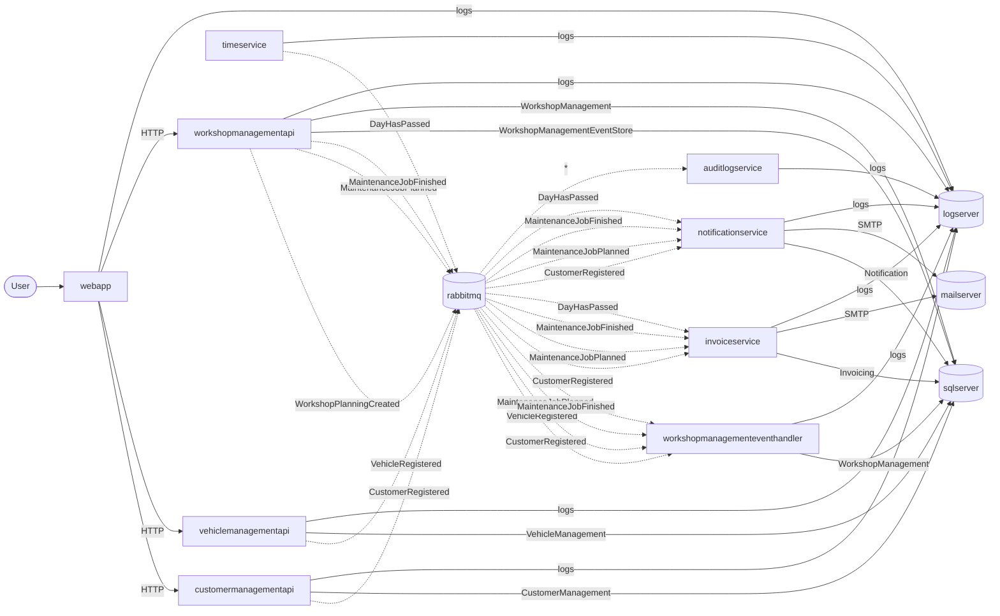

# Pitstop dependency and data-flow map

Generated by `chaos-scripts/map-dependencies.ps1` at 2026-10-11T02:15:36.2201851Z.
Regenerate after any change to `src/docker-compose.yml` or to the event handlers.

## Live state at generation time

| Service | Kind | Running | Health | Publishes | Subscribes |
| --- | --- | --- | --- | --- | --- |
| auditlogservice | service | True | no healthcheck |  | * |
| customermanagementapi | service | True | healthy | CustomerRegistered |  |
| invoiceservice | service | True | no healthcheck |  | CustomerRegistered, MaintenanceJobPlanned, MaintenanceJobFinished, DayHasPassed |
| logserver | infrastructure | True | no healthcheck |  |  |
| mailserver | infrastructure | True | no healthcheck |  |  |
| notificationservice | service | True | no healthcheck |  | CustomerRegistered, MaintenanceJobPlanned, MaintenanceJobFinished, DayHasPassed |
| rabbitmq | infrastructure | True | healthy |  |  |
| sqlserver | infrastructure | True | healthy |  |  |
| timeservice | service | True | no healthcheck | DayHasPassed |  |
| vehiclemanagementapi | service | True | healthy | VehicleRegistered |  |
| webapp | service | True | healthy |  |  |
| workshopmanagementapi | service | True | healthy | WorkshopPlanningCreated, MaintenanceJobPlanned, MaintenanceJobFinished |  |
| workshopmanagementeventhandler | service | True | no healthcheck |  | CustomerRegistered, VehicleRegistered, MaintenanceJobPlanned, MaintenanceJobFinished |

## Most depended-on components

Ranked by how many other components point at them, which is a first pass at
where a fault has the widest blast radius.

Read the edge *kind* as well as the count. `logserver` is the most connected
node only because every service ships logs to it; losing it costs observability,
not function. `sqlserver` and `rabbitmq` carry `database` and `publish`/`subscribe`
edges and are the genuine single points of failure - every user-visible workflow
stops without them. Rank experiments on that distinction, not on degree alone.

| Component | Dependents | Depended on by |
| --- | --- | --- |
| logserver | 9 | auditlogservice, customermanagementapi, invoiceservice, notificationservice, timeservice, vehiclemanagementapi, webapp, workshopmanagementapi, workshopmanagementeventhandler |
| sqlserver | 6 | customermanagementapi, invoiceservice, notificationservice, vehiclemanagementapi, workshopmanagementapi, workshopmanagementeventhandler |
| rabbitmq | 4 | customermanagementapi, timeservice, vehiclemanagementapi, workshopmanagementapi |
| mailserver | 2 | invoiceservice, notificationservice |
| auditlogservice | 1 | rabbitmq |
| customermanagementapi | 1 | webapp |
| invoiceservice | 1 | rabbitmq |
| notificationservice | 1 | rabbitmq |
| vehiclemanagementapi | 1 | webapp |
| workshopmanagementapi | 1 | webapp |
| workshopmanagementeventhandler | 1 | rabbitmq |

