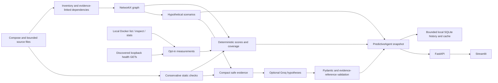

# PFIA architecture

One `PredictiveAgent` coordinates deterministic tools. FastAPI and Streamlit
are interfaces to that agent, not autonomous agents. No module imports the
existing experiment runner, invokes a shell, or writes through Docker.

## Discovery boundaries

Discovery reads `src/docker-compose.yml`, bounded source files within each build
folder, Production appsettings and the curated RabbitMQ overlay. It never scans
`.env`, vendors, `bin`, `obj`, `node_modules`, or the old alternative agent.
Bounded local C# ProjectReferences are followed within `src/`. Current service
projects reference Infrastructure.Messaging directly and Dockerfiles copy it,
despite the older AGENTS.md note describing a NuGet-only build. A configured
source reference still does not verify which image is running.
It exports environment names and recognized dependency keys, never their values.
Source/configuration bytes contribute only to a local SHA-256 fingerprint.

Compose `depends_on` gives startup edges. Production connection strings, API
locations, RabbitMQ, SMTP and Serilog configuration give runtime edges. Shared
networks alone do not establish a dependency. Unknown targets are not invented.
The curated event overlay needs source corroboration and is marked medium
confidence. A configuration edge is not a measured live connection.

Availability graph direction is consumer -> dependency. `ancestors(component)`
are potentially affected consumers; `descendants(component)` are its reachable
dependencies. Graph outputs include degree, betweenness, reachability and
shortest dependency-path reachability counts. Startup and logging links are
excluded from availability propagation. Asynchronous broker effects and partial
fallbacks are stated explicitly; business-critical paths are not inferred from
topology alone. Single-replica findings do not establish physical host placement.

## Read-only runtime and storage

Only local Docker engines and an explicitly configured Compose project label
are accepted. Containers must also match a discovered service. Metrics preserve
container identity, so replicas are not silently combined into one container.
Health uses serial GETs of discovered routes over loopback published ports, with
redirects disabled and no response bodies retained. Container state is never
reported as proof of business recovery.

SQLite stores observations, analysis snapshots, scenario evaluations, token
records and narrative cache. Retention and a global record count bound history.
Concurrent analyses are rejected with HTTP 409. The sampler calls deterministic
analysis only; LLM calls require an explicit request and backend opt-in.

## AI boundary

Groq sees compact findings and analytical scenario summaries, not raw files,
secrets, metric values, container IDs or environment values. The LLM response
schema has no score, execution field, command, target selection or recovery
decision. It can only explain hypotheses linked to supplied finding IDs.
All model output remains unverified narrative. Pydantic rejects unsupported
fields; cross-validation rejects invented services and evidence references.
There is no path from recommendations or narrative to fault execution.

The two default models support strict JSON Schema according to
[Groq's structured-output documentation](https://console.groq.com/docs/structured-outputs).
The [official Python SDK](https://github.com/groq/groq-python) is used with
retries disabled and explicit timeout/budget handling. Model availability is
checked through the account's model-list API. No live call is claimed here.

## API

Read: `/api/services`, `/api/dependencies`, `/api/metrics`, `/api/weak-nodes`,
`/api/findings`, `/api/scenarios`, `/api/recommendations`, `/api/llm-usage`,
and the complete snapshot `/api/analysis`.

Write only PFIA's local observations: `POST /api/analyze`,
`POST /api/analysis/refresh`, `POST /api/scenarios/evaluate`.
Scenario kinds are a validated enum; target names must be discovered services.
No arbitrary URLs, paths, commands or experiment execution are accepted.
